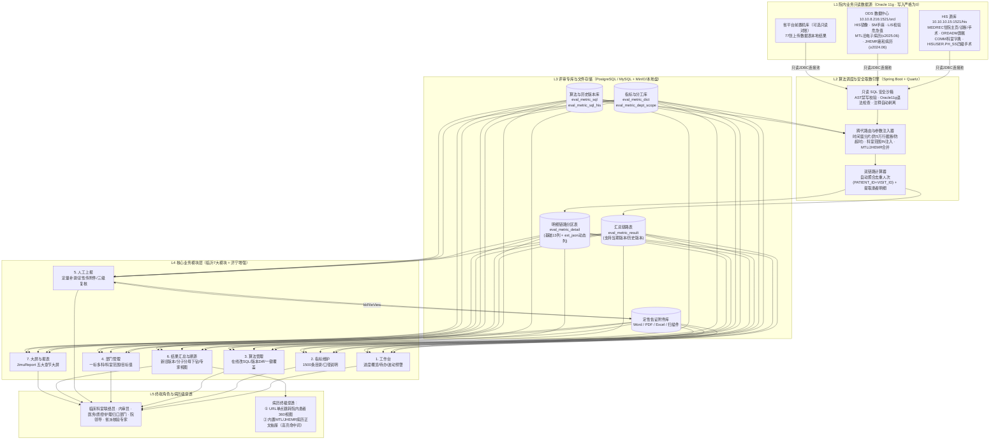

# 医院等级评审与质控指标数据集成系统 · 总体设计方案

> **前置必读**：接手本项目的 AI 或开发人员请先阅读同目录下的 `00_项目需求背景与AI接手总览.md`，了解完整的前因后果、资源地图与开发红线。  
> **编制部门**：信息科  
> **编制日期**：2026年11月12日  
> **设计策略**：以**临沂市人民医院**系统功能与“54321”三级复核流程为主骨架，融合**济宁市第一人民医院**“汇总+明细双链路落库、定性材料同屏预览、病历级穿透”内核，100% 承接本院既有 `E:\三甲复审\1、三甲复审统计指标` 规则与 SQL 资产。  
> **技术底座**：`RuoYi-Vue-Pro` + `JimuReport（积木报表/大屏）` + `kkFileView`（全开源可控架构）

---

## 一、建设背景与目标定位

根据 2026 年 11 月 12 日山东省卫健委专题会议精神，全省三级医院须在 **2027 年 1 月底前**全面实现质控指标信息化监测；同时，三甲医院复审实行“数据评审”两步走准入机制——**医院必须具备“院内质控模块”（评审指标信息提取平台）**，由 3 名信息化专家先行开展 2 天数据核验（重点核查数据真实性、多系统一致性、诊断编码规范性、原始病历可溯源性及全流程留痕），核验不过关不启动现场评审。

本方案旨在依托成熟开源框架自主研发一套贴合我院实际业务库结构、代码完全可控、零商业许可费用的**医院等级评审与质控指标数据集成系统**，核心达成以下四个目标：

1. **满足省卫健委硬性准入与省评总表一键回填**：100% 承接《三级医院评审标准（2025年版）山东省实施细则》全院总表（`数据指标导出调整版.xlsx` 共 **4,718 行：410 个章节、1,485 条评审指标、2,823 条分子/分母基础指标**）及 26 个重点专业质控指标，具备完整的指标信息化提取、版本留痕、迎检核验与原格式回填导出能力。
2. **跨异构业务库自动取数**：安全只读对接我院 **HIS 源库（`10.10.10.15`）** 与 **ODS 数据中心（`10.10.8.216`，含 HIS、手麻 SM、检验 LIS、旧版电子病历 MTL、新版嘉和电子病历 JHEMR）**，实现定量指标 T+1 或按月/季/年自动跑批，**确保业务源库写入数量严格为 0**。
3. **全院协同填报与三级复核**：支持手工统计定量指标与定性制度条款的科室在线填报、Word/PDF/Excel 佐证附件上传与在线预览，落地“**科室数据联络员初审 → 内审员人工抽查复核 → 归口职能部门终审**”三级审核签字留痕。
4. **总数—科室—患者—病历四级下钻**：点击任意定量指标的分子或分母，毫秒级下钻至患者住院明细，并一键穿透调阅患者 360 视图或电子病历原文（入院记录、病程记录、手术记录等）。

---

## 二、“临沂为主、济宁为辅”对标融合设计

结合今日省卫健委会议现场采集的两家标杆医院建设方案，取长补短确定本系统功能形态：

| 维度 | 参考来源 | 吸收的核心设计点 | 在本系统中的落地方式 |
| :--- | :--- | :--- | :--- |
| **导航与交互骨架** | **临沂为主** | 左侧仅设 **7 个核心菜单**（工作台、算法管理、指标维护、部门管理、人工上报、结果汇总、大屏展示），不堆砌冗余菜单，临床与职能科室上手极快 | 主系统菜单 1:1 对齐临沂 7 大模块，按登录人角色（联络员/内审员/职能部门/信息科/迎检专家）自动裁剪可见范围 |
| **SQL 算法与版本管理** | **临沂为主** | 在线修改统计 SQL、标注提取方式图标（系统/人工/组合）、保存**算法修改历史记录**（修改类型、生效/失效时间、修改前代码）、新增**“覆盖评审数据”一键重算按钮**并区分**当期版本/历史版本** | 内置 Monaco SQL 编辑器，利用“算法生效/失效年月”天然兼容我院 **MTL（≤2025.06）与 JHEMR（≥2024.06）** 双电子病历分段取数及历史快照对比 |
| **三级复核治理流程** | **临沂为主** | “54321”数据治理三级复核：一级科室联络员自查提交 → 二级内审员抽查病历核对签字（有问题退回整改） → 三级职能部门 100% 归口终审 | 基于 `RuoYi-Vue-Pro` 自带状态机/Flowable 实现轻量三级签字流，直接导入我院现有《科室分工与联络人表》绑定账号 |
| **底层数据存储链路** | **济宁为辅** | **L4“汇总数据层 + 明细数据层”双链路落库**（`metric_result` + `metric_detail`），跑批时同步落库汇总数与患者流水号明细 | 彻底规避迎检现场实时跨 Oracle 大表（如 2.19 亿行费用表）慢查询风险，实现汇总秒开、分子/分母明细弹窗秒出 |
| **定性材料在线预览** | **济宁为辅** | 按评审条款建立制度与佐证文档目录树，点击“预览”在右侧同屏直接查看 Word/PDF 红头文件，免下载 | 集成开源 `kkFileView` 文档预览服务，支持 `.doc/.docx/.pdf/.xlsx/.jpg` 在线同屏预览与水印保护 |
| **迎检同屏溯源展示** | **济宁为辅** | 同一核验界面串联展示：**趋势图 + 指标口径说明 + 实际执行 SQL（含中文注释） + 患者明细列表 + 入院/病程记录原文** | 专为省派 3 名信息化专家 2 天核验定制“专家核验抽屉”，支持跳转院内 360 视图 + 内置 MTL/JHEMR 病历正文直读双保障 |

---

## 三、总体技术架构与开源选型

### 3.1 开源组件选型清单

| 层级 | 选用开源项目 / 组件 | 版本建议 | 承担职责 | 选型理由 |
| :--- | :--- | :--- | :--- | :--- |
| **前后端基础底座** | [YunaiV/ruoyi-vue-pro](https://github.com/YunaiV/ruoyi-vue-pro) | JDK 17/21 + Spring Boot 3.2 + Vue 3 + Element Plus | 科室组织树、RBAC 数据权限、三级复核流、Quartz 定时调度、操作审计日志 | 代码结构规整、无黑盒封装，自带 `dynamic-datasource` 多数据源组件，极易自主维护与二次开发 |
| **复杂报表与大屏** | [jeecgboot/JimuReport](https://github.com/jeecgboot/JimuReport) | 最新安全版（v2.x+，仅内网部署） | 跨年度对比交叉表、导出打印模板、5 大章节监测驾驶舱大屏（JimuBI） | 类 Excel 在线设计复杂中国式报表，原生支持参数钻取与多数据源看板，省去大量手写 ECharts 工作 |
| **佐证文档在线预览** | [kekingcn/kkFileView](https://github.com/kekingcn/kkFileView) | v4.4+（Docker 独立部署） | 定性条款制度文件、扫描件、台账附件在线免下载预览 | 医院内网离线可用，一行 URL 即可嵌入 Vue 右侧抽屉预览 |
| **在线 SQL 编辑器** | `monaco-editor` + `sql-formatter` | 前端 NPM 组件 | 算法管理页的 Oracle SQL 高亮编辑、格式化、新旧版本代码 Diff 对比 | VS Code 同款内核，查看历史算法变更差异一目了然 |
| **评审系统专库** | PostgreSQL 15 或 MySQL 8.0 | 独立部署于评审应用服务器 | 存储评审指标库、SQL 版本、汇总结果、患者级溯源明细、审核留痕 | 支持 JSONB 动态扩展列（存不同专科个性化明细字段）与按年份表分区，百万级患者明细毫秒级检索 |
| **业务只读数据源** | Oracle JDBC (`ojdbc8`) | 适配院内 **Oracle 11g** | 只读连接 `HIS源库(10.10.10.15)` 与 `ODS库(10.10.8.216)` | 严格使用数据库只读账号 + 应用层只读 SQL 拦截器，兼容 Oracle 11g `ROWNUM` 与 `CLOB` 读取 |
| **历史资产迁移器** | Python 3.11 (`openpyxl` + `sqlglot`) | 复用本机 Python 环境 | 一键解析 `E:\三甲复审\1、三甲复审统计指标` 下的 Excel 主表与 3,090 个 `.sql` 文件入库 | 避免人工逐条复制粘贴 3,000 多条 SQL，实现既有成果零损耗平滑入库 |

### 3.2 系统逻辑架构图



---

## 四、本院特殊业务场景的针对性架构设计（核心关键点）

通用商业软件最容易在我院“水土不服”的地方，正是前期在 `E:\三甲复审\1、三甲复审统计指标` 梳理出的真实复杂场景。本方案在底层做原生支持：

### 4.1 “一标多科”实例拆分、科室级 SQL 挂载与全院防重复汇总
- **现状痛点**：经实测盘点，根目录 12 个已完成单专业表的 **459 个指标**按科室展开达 **1,452 行实例**——其中肿瘤专业拆给 **17 个科室（410 行）**、神经系统 **5 个科室（440 行）**、心血管 **6 个科室（404 行）**、疼痛 **5 个科室**、脑损伤与感染各 **3 个科室**；Excel 采用合并单元格（`A 列指标名为空、负责科室列有值`）表示多科室子行，存在“请外科统计/本科室无手术/未开展”等免统子行，且同一指标在不同科室的提取方式与专属 `DEPT_NAME IN (...)` 过滤范围并不完全相同。
- **系统设计**：
  1. **父子两层解耦与免统识别**：将“**评审标准指标（`eval_metric_dict`）**”与“**科室填报/考核实例（`eval_metric_dept_scope`）**”解耦。导入时合并单元格子行自动向下继承主指标；对写明“无手术/未开展/请外科统计”的子行自动标记 `skip_flag = true` 并记录原因，既保留分工台账，又不在【人工上报】派发无效待办或填假 `0`。
  2. **SQL 挂载到“科室实例级（`scope_id`）”**：`eval_metric_sql` 支持直接按 `(metric_id, scope_id)` 绑定各科室专属 SQL（同时识别 `NUM_DTL/DEN_DTL` 患者明细型与 `NUM_SUM/DEN_SUM` 聚合统计型），并支持 `extract_mode_override` 按科室覆盖提取方式（如 A 科全自动提取、B 科“系统提分母+临床勾选分子”、C 科免统），无需推翻重写既有 3,090 条已核验科室 SQL。
  3. **全院汇总“防重复计分”双规则（`agg_mode`）**：
     - **纯手工指标 / 聚合型 SQL 指标（`DEPT_SUM`）**：全院汇总分子、分母由各非免统责任科室确认后的数值累加生成；
     - **患者明细型指标（`DEDUP_DTL`，含系统提取与混合勾选）**：为防止跨科转科患者在多个科室间重复计分导致全院总数虚高，全院汇总行（`scope_id = 0`）直接基于各科落库确认的 `eval_metric_detail` 明细池按 **`PATIENT_ID + VISIT_ID` 全院去重计数**生成，确保回填省评总表的数字严丝合缝、100% 可穿透至具体病历。
  4. **一标多科三级复核门禁**：父指标下实时展示“已复核 X / 应交 Y 科”进度矩阵；仅当所有 `skip_flag = false` 的责任科室均完成一级初审提交与二级内审通过后，归口职能部门方可触发全院【终审归档】。

### 4.2 电子病历跨代切换（MTL + JHEMR）无缝兼容
- **现状痛点**：我院 2025 年 6 月前使用 **MTL（EPR）** 电子病历，2024 年 6 月起上线 **JHEMR（嘉和）** 电子病历（2024.06–2025.06 为双系统并行期，实际文书不重复）。现有主表 Excel 中有 10 个专业采用“**四列 SQL**”（2021–2024 分子/分母走 MTL，2025 分子/分母走 JHEMR）。
- **系统设计**：
  - 在 `eval_metric_sql` 算法表中设置 **`period_start`（生效起始年月，如 `202101`）** 与 **`period_end`（生效截止年月，如 `202412`）** 字段（与临沂医院“生效时间/失效时间”界面完全一致）。
  - 针对现有“四列型 SQL”，迁移脚本可直接拆成两条时段算法入库（`202101~202412` 调 MTL 算法，`202501~999912` 调 JHEMR 算法）；对于新写的统一 SQL，也完全支持在单条 SQL 内按确认规则使用 `MTL UNION ALL JHEMR` 并输出 `文书系统` 字段。

### 4.3 “核查版带注释 SQL”与“无注释执行版 SQL”双态存储
- **现状痛点**：迎检时省信息化专家需要看带中文业务注释（`--`）的清晰 SQL 以核查口径逻辑，而部分底层只读执行器或特殊驱动对内嵌 `--` 注释敏感；同时部分手工/混合指标“只提分母 SQL、分子由临床基于分母明细人工筛选”（如医疗部或部分专科指标）。
- **系统设计**：
  - 算法表同时保存 `sql_annotated`（前端展示与专家核验用，完整保留中文注释）和 `sql_executable`（保存时由后端词法器安全剥离注释、替换时间窗参数，绝不破坏字符串常量内的字符）。
  - **支持“半自动混合提取（系统提分母 + 临床勾选分子）”**：对“分子需人工筛选”的指标，系统先自动跑出分母患者明细池（如某病种全年 86 例出院患者），科室联络员在【人工上报】页直接打开这 86 例患者列表，点开病历核实后勾选符合分子条件的病例并填写说明，系统自动汇总勾选数作为分子——**既解放了临床查病历的工作量，又保证了分子 100% 有病例明细支撑！**（这一点比纯手工填一个死数字更能通过省专家的数据溯源核验！）

### 4.4 Oracle 11g 大表防卡死与自动分片机制
- **现状痛点**：`HIS.INP_BILL_DETAIL`（2.19 亿行）、`LIS.LAB_RESULT`（9631 万行）跨多年全扫极易超 120s 断开，且单次拉取超 50,000 行易内存溢出。
- **系统设计**：
  - 调度引擎在执行多年份补数（如补跑 2022–2026 年）时，**自动将时间区间按“自然月”或“自然季”拆分为独立小窗口顺序执行**（每次仅传单月左闭右开参数 `>= DATE '2025-01-01' AND < DATE '2025-02-01'`），拉回明细写入评审专库后再按年聚合去重（`COUNT(DISTINCT patient_id || '-' || visit_id)`）。
  - 严控并发度：后台跑批线程池对 HIS/ODS 只读连接池限制最大并发 `<= 3`，定时任务默认在凌晨 `01:00–05:30` 执行；白天点“覆盖评审数据”仅允许按单指标、单年度触发。

### 4.5 省评总表“三层双编码”映射与原格式一键回填
- **现状痛点**：全院权威总表 `数据指标导出调整版.xlsx` 并非单层指标表，而是由 **410 行`章节` + 1,485 行`指标`（如 `25.2.3.3.5.1.1`，存比率或定性结论）+ 2,823 行`基础指标`（如 `0.25.252.1` 分子 / `0.25.252.2` 分母原子填报行，另有 `ICU-05`、危急值、多院区床位等 5 条复合指标含 3～14 个基础指标子行）** 构成的三层树；而各单专业 `.xlsx` 与 `.sql` 文件则使用 `NEU-EPI-01` 等专科英文代码或中文指标名。
- **系统设计**：
  - 在 `eval_metric_dict` 中同时保存总表层级 `metric_code`（如 `25.2.3.3.5.1.1`）、专科代号 `alias_code`（如 `NEU-EPI-01`）、原表行序 `master_row_no`，以及下属分子 `num_atom_code`（`0.25.252.1`）、分母 `den_atom_code`（`0.25.252.2`）和复合原子项 `extra_atoms_json`。
  - 实测经去空格与括号标准化后，现有重点专业指标可 **100% 精准映射**至总表对应行；迎检或上报时，系统可按总表原始 4,718 行结构一键导出回填完毕的各年度 `数据`（比率/定性值及分子分母原子值）与 `数据来源` 标准 Excel。

---

## 五、七大功能模块详细设计

### 5.1 工作台（角色化门户）
- **顶部概览卡片**：展示评审指标总数（如 1500 条，标注适用 1291 条 / 不适用 209 条）、按提取方式分类计数（系统提取 / 人工填报 / 系统+人工组合）、当月与本年度整体填报审核完成率。
- **待办事项中心**：
  - 临床联络员登录：看到本科室“待自查确认指标”“被内审员退回需整改指标”；
  - 内审员/职能部门登录：看到分管科室“待人工复核/待归口终审”队列；
  - 信息科登录：看到“昨晚定时跑批失败/超时 SQL 告警”“结果为 0 异常波动告警”。
- **各部门任务进度矩阵**：按医务部、护理部、院感办、药学部、门诊部等归口部门，按月展示完成率色块（绿=100%，黄=推进中，红=滞后）。
- **异常指标实时预警**：为重点指标配置阈值或导向规则（如平均住院日连续升高、I 类切口感染率超阈值、某指标突然出现分母/分子为 0），自动亮灯提醒。

### 5.2 指标维护（全院统一指标字典库）
- 按《三级医院评审标准（2025年版）山东省实施细则》章节树管理：
  - 第一部分：前置条款（29 条一票否决红线监测）
  - 第二部分：医疗服务能力与医院质量安全监测数据（资源配置、医疗服务与质量安全、27 个重点专业质控指标、单病种质控、重点医疗技术）
  - 第三部分：现场检查 / 医院管理与高质量发展定性及定量条款
- 每条指标维护：总表指标编号（如 `25.2.3.3.5.1.1`）、专科代号（如 `NEU-EPI-01`）、下属分子/分母基础指标编号（如 `0.25.252.1` / `0.25.252.2`）、指标名称、指标属性（定量/定性）、指标分类（评价/监测）、计量单位、指标导向（逐步提高/逐步降低/监测比较/符合标准）、采集方式（系统提取/人工填报/系统+人工组合，配醒目图标）、多科汇总策略（明细全院去重/分科累加）、是否适用本院（承接总表 803 项不适用基线）、**国家标准计算方法**、**我院实际统计口径说明**（允许归口部门在线修订说明并留痕）。

### 5.3 算法管理（信息科核心工作台）
- **多数据源配置**：内置 `ODS_RO (10.10.8.216)`、`HIS_RO (10.10.10.15)` 等加密凭据配置与连通性测试。
- **三合一 SQL 维护**：针对每条定量指标（或科室实例），维护：
  1. `分子明细 SQL`（输出标准患者级列，系统可自动按 `PATIENT_ID+VISIT_ID` 去重算出分子汇总，也支持单独写 `分子汇总 SQL`）；
  2. `分母明细 SQL`（同上）；
  3. `生效起止年月`（默认全时段，涉及 MTL/JHEMR 切换的可分段挂接两套 SQL）。
- **算法校验（沙箱试跑）**：点击“算法校验”，自动包裹 `ROWNUM <= 20` 及最近 1 个月时间窗试跑，当场展示返回字段、耗时及前 20 行样例数据，校验列名是否符合规范。
- **即时重算（“覆盖评审数据”按钮）**：算法优化修复后，选择重算年份/月份区间，点击一键重跑。系统可选择“更新当期草稿”或“生成新批次并保留旧结果至【历史版本】”。
- **历史算法调整记录**：每次保存强制填写修改类型（新增 / 口径升级 / 算法 Bug 修复）及修改原因，自动归档修改前 SQL，支持左右分栏 Diff 高亮对比。

### 5.4 部门管理与归口分工
- 顶部展示各归口职能部门卡片及所辖指标数（医务部、院感部、护理部、药学部、门诊部、运营管理部、质管部、信息科等）。
- 支持将指标批量分配至归口职能部门，并进一步拆解到具体临床医技科室，配置每科对应的底层 HIS/ODS `DEPT_CODE` 精确集合与年度目标值。
- 支持一键下载 Excel 模板与批量导入分工。

### 5.5 人工上报与“54321”三级复核
- **定量手工/混合填报**：
  - 纯手工指标：科室按年度/季度/月度填入分子、分母（系统自动算比率，上报省平台时仅报分子分母），并必须上传原始手工登记本扫描件或 Excel 明细台账作为佐证（呼应省卫健委“杜绝无原始数据支撑”要求）；
  - 混合指标（分母系统提、分子人工筛）：直接在系统生成的分母患者清单上勾选命中分子病例并备注依据。
- **定性条款一键上传与同屏预览**：
  - 按条款编号建立多级文件夹目录（如制度文件、培训记录、演练照片、会议纪要、PDCA 持续改进案例），支持批量拖拽上传；
  - 右侧集成 `kkFileView`，点击任意文件名直接在右侧窗口渲染正文，无需下载到本地。
- **三级复核工作流**：
  - `草稿` → 科室联络员点【提交初审】（记录签名+时间） → 内审员抽查病历/附件后点【复核通过】或【退回整改（必填退回意见）】 → 归口职能部门点【终审归档】（归档后锁定不可随意篡改，确需变更须走解锁留痕）。

### 5.6 结果汇总与四级下钻溯源（迎检核心界面）
- **新旧版本切换**：左侧菜单在【结果汇总】下设 `当期版本` 与 `历史版本`，切换即可查看算法调整前后的历史固封数据，向专家完整还原数据治理演进过程。
- **章节与专业快速导航**：支持按评审章节、27 个重点专业、单病种、归口部门、提取方式、零值异常（分子=0 或 分母=0）快速筛选。
- **四级下钻交互链**：
  1. **看指标全貌**：列表展示 2022–2026 各年及各月分子、分母、指标值、同比变化；右侧面板同步展示责任部门、国家公式、我院统计口径、历史版本趋势折线及实际执行 SQL。
  2. **钻科室分布**：一标多科指标点击展开，直接看各临床病区的分子、分母贡献度对比。
  3. **钻患者明细**：点击任意年份/月份蓝字“分子”或“分母”数值 → 弹窗秒开 `eval_metric_detail` 患者清单（展示住院号、患者ID、姓名、住院次数、出院主诊断编码与名称、主手术编码与名称、入院/出院科室、入院/出院时间，以及手麻/医嘱/危急值等专科扩展列），支持搜索与 Excel 导出。
  4. **钻电子病历原文**：点击患者明细中的“查看病历/360视图”：
     - **方式 A（外跳院内 360）**：拼接住院号/患者ID 参数，新标签页打开院内现有患者 360 视图；
     - **方式 B（内置病历原文抽屉）**：后端按 `PATIENT_ID + VISIT_ID`（JHEMR）或 `INP_NO + VISIT_ID`（MTL）只读实时提取该次住院的入院记录、首次病程、手术记录、出院记录 CLOB 文本，在弹窗内直接排版展示并高亮口径关键词（如“NIHSS”“Brunnstrom”“术后镇痛”），确保任何核验电脑上都能 100% 看到病历铁证。
- **省评总表原格式一键导出**：支持按年度区间一键生成与 `数据指标导出调整版.xlsx` 完全同构的三层回填总表（自动填入 1,485 行指标结果值、2,823 行分子/分母基础指标值及对应 `数据来源`）。

### 5.7 大屏展示与省平台 77 张表对账中心
- **五大章节监测大屏**：通过 `JimuBI` 构建医院标准化建设监测总览大屏（床位配置、卫技人员配比、运行效率 CMI/均次费用、重点专业质控达标率、单病种与核心技术监测）。
- **省平台质控指标对账专区（特色增值模块）**：导入或对接省全民健康信息平台“医疗质控指标管理模块”反馈的计算结果，与本系统计算结果逐项自动比对，自动标红“省平台分母为 0 / 分子为 0”或“院省偏差 > 5%”的指标，辅助数据小组快速定位是值域字典未对照还是前置机漏传。

---

## 六、核心数据库表结构设计（评审专库 DDL 蓝图）

评审专库建议使用 **PostgreSQL 15+**（对 `JSONB` 索引和分区表支持极佳；若院内运维统一用 MySQL 8.0 亦可直接平替 JSON 类型）。除 `RuoYi-Vue-Pro` 自带的 `sys_user`、`sys_dept`、`sys_role`、`sys_oper_log` 外，核心新建以下 **8 张业务表**：

```sql
-- 1. 评审指标主字典表（对齐《数据指标导出调整版.xlsx》1,485条主指标 + 2,823条基础指标三层结构）
CREATE TABLE eval_metric_dict (
    id                  BIGSERIAL PRIMARY KEY,
    metric_code         VARCHAR(64)  NOT NULL UNIQUE,   -- 总表标准指标编号，如 25.2.3.3.5.1.1
    alias_code          VARCHAR(64),                    -- 重点专业/单病种英文代号，如 NEU-EPI-01 / ICU-05
    master_row_no       INT,                            -- 对应总表原始行号，保障原序1:1回填导出
    num_atom_code       VARCHAR(64),                    -- 下属分子（或单值/定性）基础指标编号，如 0.25.252.1
    den_atom_code       VARCHAR(64),                    -- 下属分母基础指标编号，如 0.25.252.2
    extra_atoms_json    JSONB,                          -- 含≥3个基础指标的复合子项映射（如ICU-05的1h/3h/6h bundle、门急住危急值等）
    chapter_part        VARCHAR(32)  NOT NULL,          -- 部分：PART1前置 / PART2管理与发展 / PART3医疗服务与质控监测
    chapter_code        VARCHAR(64),                    -- 所属总表末级章节编号，如 25.2.3.3.5.1
    chapter_path        VARCHAR(255) NOT NULL,          -- 章节全路径，如 第三章/五、神经系统疾病/(一)癫痫
    specialty_code      VARCHAR(64),                    -- 所属重点专业/单病种编码
    metric_name         VARCHAR(255) NOT NULL,          -- 指标名称
    metric_attr         VARCHAR(16)  NOT NULL,          -- 定量指标 / 定性指标
    metric_category     VARCHAR(16),                    -- 评价指标 / 监测指标
    unit                VARCHAR(32),                    -- 计量单位：%、例、天、分钟等
    direction           VARCHAR(32),                    -- 逐步提高 / 逐步降低 / 监测比较 / 符合标准
    extract_mode        VARCHAR(16)  NOT NULL,          -- SYS(系统提取) / MANUAL(人工填报) / HYBRID(系统+人工) / PROV(省级提取)
    agg_mode            VARCHAR(16)  DEFAULT 'DEDUP_DTL', -- 多科汇总策略：DEDUP_DTL(按明细PATIENT_ID+VISIT_ID全院去重) / DEPT_SUM(各科数值累加)
    is_applicable       BOOLEAN      DEFAULT TRUE,      -- 本院是否适用（承接总表803项不适用基线并记录原因）
    inapplicable_reason VARCHAR(500),                   -- 不适用原因说明
    std_formula_desc    TEXT,                           -- 国家标准计算方法（分子/分母文字定义）
    hosp_caliber_desc   TEXT,                           -- 我院实际统计口径说明（前端实时维护留痕）
    data_sys_source     VARCHAR(255),                   -- 业务系统来源说明（如 HIS / ODS / 瑞美LIS / 手麻系统）
    owner_func_dept_id  BIGINT,                         -- 归口职能部门ID（医务部/护理部/院感等）
    dedup_granularity   VARCHAR(32)  DEFAULT 'VISIT',   -- 去重粒度：VISIT(PATIENT_ID+VISIT_ID) / PATIENT / OPER / RAW
    target_value        NUMERIC(12,4),                  -- 目标参考值/阈值
    sort_order          INT          DEFAULT 0,
    status              SMALLINT     DEFAULT 1,
    create_time         TIMESTAMP    DEFAULT CURRENT_TIMESTAMP,
    update_time         TIMESTAMP    DEFAULT CURRENT_TIMESTAMP
);
CREATE INDEX idx_dict_alias_code ON eval_metric_dict(alias_code);

-- 2. “一标多科”科室责任分解与过滤范围表
CREATE TABLE eval_metric_dept_scope (
    id                  BIGSERIAL PRIMARY KEY,
    metric_id           BIGINT       NOT NULL REFERENCES eval_metric_dict(id),
    resp_dept_id        BIGINT       NOT NULL,          -- 临床/医技责任科室ID（对应分工表“负责部门/科室”）
    resp_dept_name      VARCHAR(128) NOT NULL,
    his_dept_codes      TEXT,                           -- 实际SQL过滤的HIS/ODS科室编码逗号串，如 '030503,030505'
    his_dept_names      TEXT,                           -- 对应“科室范围”标准名称串，供核查展示
    liaison_user_id     BIGINT,                         -- 第一级：科室数据联络员（初审人）
    auditor_user_id     BIGINT,                         -- 第二级：职能部门对接内审员（复核人）
    func_leader_user_id BIGINT,                         -- 第三级：归口职能部门终审负责人
    extract_mode_override VARCHAR(16),                  -- 允许个别科室覆盖提取方式（如未开展手术跳过）
    skip_flag           BOOLEAN      DEFAULT FALSE,     -- 是否免统/跳过（如“本科室无手术”）
    skip_reason         VARCHAR(255),
    UNIQUE (metric_id, resp_dept_id)
);

-- 3. 指标 SQL 算法配置表（支持 MTL / JHEMR 分时段多版本路由）
CREATE TABLE eval_metric_sql (
    id                  BIGSERIAL PRIMARY KEY,
    metric_id           BIGINT       NOT NULL REFERENCES eval_metric_dict(id),
    scope_id            BIGINT,                         -- 为空代表全院通用SQL；有值代表特定科室定制SQL
    sql_role            VARCHAR(16)  NOT NULL,          -- NUM_DTL(分子明细) / DEN_DTL(分母明细) / NUM_SUM / DEN_SUM
    datasource_key      VARCHAR(32)  NOT NULL,          -- ODS_RO / HIS_RO
    period_start        VARCHAR(6)   NOT NULL DEFAULT '202101', -- 生效起始年月 YYYYMM（如MTL配202101~202412）
    period_end          VARCHAR(6)   NOT NULL DEFAULT '999912', -- 生效截止年月 YYYYMM（如JHEMR配202501~999912）
    time_field_expr     VARCHAR(128),                   -- 分片时间字段，如 v.DISCHARGE_DATE_TIME / m.START_DATE_TIME
    sql_annotated       TEXT         NOT NULL,          -- 带中文注释的核查版 SQL（前端与专家可见）
    sql_executable      TEXT         NOT NULL,          -- 自动去注释后的执行版 SQL（含 #{startTime}, #{endTime}, #{deptCodes}）
    version_no          INT          NOT NULL DEFAULT 1,
    is_active           BOOLEAN      DEFAULT TRUE,
    last_verify_status  SMALLINT     DEFAULT 0,         -- 0未校验 1校验通过 2校验报错
    last_modify_user    VARCHAR(64),
    last_modify_reason  VARCHAR(500),
    update_time         TIMESTAMP    DEFAULT CURRENT_TIMESTAMP
);

-- 4. 算法修改历史记录表（对应临沂“查看历史算法调整记录”）
CREATE TABLE eval_metric_sql_his (
    id                  BIGSERIAL PRIMARY KEY,
    sql_id              BIGINT       NOT NULL,
    metric_id           BIGINT       NOT NULL,
    sql_role            VARCHAR(16)  NOT NULL,
    version_no          INT          NOT NULL,
    change_type         VARCHAR(32)  NOT NULL,          -- 新增 / 需求口径升级 / 算法Bug修复
    change_reason       VARCHAR(500) NOT NULL,
    period_start        VARCHAR(6),
    period_end          VARCHAR(6),
    old_sql_annotated   TEXT,                           -- 修改前完整 SQL，供 Monaco Diff 对比
    new_sql_annotated   TEXT,
    modify_user_id      BIGINT,
    modify_user_name    VARCHAR(64),
    modify_time         TIMESTAMP    DEFAULT CURRENT_TIMESTAMP
);

-- 5. 数据跑批与版本快照批次表（支撑“当期版本 vs 历史版本”与“覆盖评审数据”）
CREATE TABLE eval_exec_batch (
    id                  BIGSERIAL PRIMARY KEY,
    batch_no            VARCHAR(64)  NOT NULL UNIQUE,   -- 如 BATCH_20261112_NIGHT / RECALC_20261112_01
    trigger_type        VARCHAR(16)  NOT NULL,          -- CRON(定时T+1) / MANUAL_COVER(手动覆盖) / IMPORT(历史导入)
    is_current_version  BOOLEAN      DEFAULT TRUE,      -- TRUE=当期展示版本，FALSE=归入【历史版本】供溯源对比
    version_tag         VARCHAR(64),                    -- 如 '2026年11月口径修订前快照'
    exec_status         VARCHAR(16)  NOT NULL,          -- RUNNING / SUCCESS / PARTIAL_FAIL / FAILED
    total_tasks         INT          DEFAULT 0,
    success_tasks       INT          DEFAULT 0,
    fail_tasks          INT          DEFAULT 0,
    operator_name       VARCHAR(64),
    start_time          TIMESTAMP    DEFAULT CURRENT_TIMESTAMP,
    end_time            TIMESTAMP
);

-- 6. L4 汇总数据层：指标结果汇总表
CREATE TABLE eval_metric_result (
    id                  BIGSERIAL PRIMARY KEY,
    batch_id            BIGINT       NOT NULL REFERENCES eval_exec_batch(id),
    metric_id           BIGINT       NOT NULL REFERENCES eval_metric_dict(id),
    scope_id            BIGINT       DEFAULT 0,         -- 0代表全院去重汇总行，>0代表具体临床科室行
    stat_period_type    VARCHAR(8)   NOT NULL,          -- YEAR / QUARTER / MONTH
    stat_period         VARCHAR(16)  NOT NULL,          -- 如 '2025' / '2025-Q1' / '2025-08'
    numerator_val       NUMERIC(18,4),                  -- 分子数值（系统提取或人工录入）
    denominator_val     NUMERIC(18,4),                  -- 分母数值
    result_val          NUMERIC(18,4),                  -- 计算结果现况值（百分比/比值/均数，仅展示用，上报仍传原分子分母）
    qualitative_result  VARCHAR(64),                    -- 定性指标结果：是/否/符合/部分符合/等级A等
    atom_values_json    JSONB,                          -- 含≥3个基础指标的复合子项结果键值（如 {"0.25.957.0.1": 12, ...}）
    data_source_tag     VARCHAR(16)  NOT NULL,          -- SYS / MANUAL / HYBRID
    sql_version_num     INT,                            -- 计算时使用的分子SQL版本号
    sql_version_den     INT,                            -- 计算时使用的分母SQL版本号
    audit_status        VARCHAR(16)  DEFAULT 'DRAFT',   -- DRAFT / L1_SUBMIT / L2_PASS / L2_REJECT / L3_ARCHIVED
    is_current          BOOLEAN      DEFAULT TRUE,      -- 冗余标记方便高频查询当期结果
    update_time         TIMESTAMP    DEFAULT CURRENT_TIMESTAMP
);
CREATE INDEX idx_res_metric_period ON eval_metric_result(metric_id, stat_period, is_current);

-- 7. L4 明细数据层：患者级溯源明细表（建议按 stat_year 分区）
CREATE TABLE eval_metric_detail (
    id                  BIGSERIAL,
    batch_id            BIGINT       NOT NULL,
    metric_id           BIGINT       NOT NULL,
    scope_id            BIGINT       DEFAULT 0,
    stat_year           INT          NOT NULL,          -- 分区键：2022, 2023, 2024, 2025, 2026...
    stat_month          VARCHAR(7),                     -- YYYY-MM
    role_type           VARCHAR(8)   NOT NULL,          -- NUM(分子明细) / DEN(分母明细)
    manual_selected     BOOLEAN      DEFAULT TRUE,      -- 混合模式下供临床在分母池中勾选是否为分子
    patient_id          VARCHAR(64),                    -- 患者ID (PATIENT_ID)
    inp_no              VARCHAR(64),                    -- 住院号/门诊号 (INP_NO)
    visit_id            VARCHAR(32),                    -- 住院次数 (VISIT_ID)
    patient_name        VARCHAR(64),                    -- 姓名
    admit_dept_name     VARCHAR(128),                   -- 入院科室
    discharge_dept_name VARCHAR(128),                   -- 出院/当前科室
    admit_time          TIMESTAMP,                      -- 入院/就诊时间
    discharge_time      TIMESTAMP,                      -- 出院时间
    main_diag_code      VARCHAR(64),                    -- 出院主要诊断编码
    main_diag_name      VARCHAR(255),                   -- 主要诊断名称
    main_oper_code      VARCHAR(64),                    -- 第一位手术编码
    main_oper_name      VARCHAR(255),                   -- 第一位手术名称
    emr_sys_source      VARCHAR(16),                    -- 文书来源：MTL / JHEMR / NULL
    emr_doc_id          VARCHAR(128),                   -- 文书唯一标识（UHID+段落号 或 FILE_UNIQUE_ID）
    emr_doc_title       VARCHAR(255),                   -- 命中文书名称（如 入院记录 / 术后首次病程）
    ext_json            JSONB,                          -- 专科个性化展示列（如麻醉复苏时间、医嘱名称、危急值内容等）
    PRIMARY KEY (id, stat_year)
) PARTITION BY RANGE (stat_year);

-- 8. 人工填报佐证材料与“54321”三级复核签字留痕表
CREATE TABLE eval_manual_evidence (
    id                  BIGSERIAL PRIMARY KEY,
    metric_id           BIGINT       NOT NULL,
    scope_id            BIGINT       DEFAULT 0,
    stat_period         VARCHAR(16)  NOT NULL,
    folder_category     VARCHAR(128),                   -- 佐证分类目录：制度汇编/培训考核/督导检查/原始登记本
    file_name           VARCHAR(255) NOT NULL,
    file_path           VARCHAR(500) NOT NULL,          -- MinIO 或内网存储相对路径
    file_ext            VARCHAR(16),
    file_size           BIGINT,
    remark              VARCHAR(500),
    upload_user_id      BIGINT,
    upload_user_name    VARCHAR(64),
    upload_time         TIMESTAMP    DEFAULT CURRENT_TIMESTAMP
);

CREATE TABLE eval_audit_log (
    id                  BIGSERIAL PRIMARY KEY,
    result_id           BIGINT       NOT NULL,          -- 关联 eval_metric_result.id
    audit_level         VARCHAR(16)  NOT NULL,          -- L1_LIAISON(科室初审) / L2_AUDITOR(内审复核) / L3_FUNC(职能终审)
    action              VARCHAR(16)  NOT NULL,          -- SUBMIT / APPROVE / REJECT / UNLOCK
    opinion             VARCHAR(1000),                  -- 复核意见、抽查病历号记录或退回整改原因
    operator_id         BIGINT       NOT NULL,
    operator_name       VARCHAR(64)  NOT NULL,
    operator_dept       VARCHAR(128),
    operate_ip          VARCHAR(64),
    operate_time        TIMESTAMP    DEFAULT CURRENT_TIMESTAMP
);
```

---

## 七、系统安全、性能与运维保障规范

1. **生产库零写入铁律（双重熔断保护）**：
   - 数据库层：向 DBA 申请专用只读账号，仅授予所需业务表的 `SELECT` 权限，无任何 DML/DDL/锁表权限；
   - 应用层：所有动态 SQL 进入 JDBC 执行前，必须经过 AST 语法树校验——仅放行以 `SELECT` 或 `WITH` 开头的单条查询语句，包含分号多语句、`INSERT/UPDATE/DELETE/MERGE/EXEC/CALL/FOR UPDATE` 的一律直接阻断并记录安全告警。
2. **网络与部署架构**：
   - 目标部署宿主机为院内 **`10.10.8.75`（业务标识：`ai病历质控`，登录用户 `root`，SSH 别名建议 `hospital-eval-75`，凭据严格通过本机免密与受控 `.env` 管理，严禁硬编码密码）**；
   - **既有服务共存与端口隔离**：本系统全部容器、数据卷与备份统一隔离部署于 `/opt/hospital-eval/` 目录，采用高段端口（默认前端 `18080`、后端 `48080`、PostgreSQL `15432`、Redis `16379`、`kkFileView` `18012`），部署前必须先只读探查端口与容器，严禁干扰该宿主机既有“AI 病历质控”业务服务；
   - 应用服务器打通至 `10.10.8.216:1521`（ODS）与 `10.10.10.15:1521`（HIS 只读端）内网白名单访问；`JimuReport` 与 `kkFileView` 严禁暴露公网端口，所有接口统一挂载在 `RuoYi-Vue-Pro` 登录鉴权网关之后。
3. **数据备份与防篡改**：
   - 评审专库每日凌晨自动 `pg_dump` / `mysqldump` 异机备份至院内备份存储；佐证材料目录每日增量同步；
   - 已终审归档（`L3_ARCHIVED`）的数据及修改前 SQL 历史快照（`eval_metric_sql_his`）仅支持追加留痕，不支持物理删除，完全满足省卫健委“全程留痕、可追溯”核查标准。
