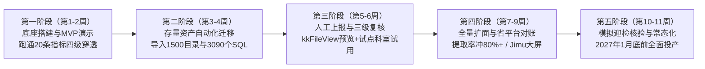

# 医院等级评审与质控指标数据集成系统 · 分步实施方案

> **前置必读**：接手本项目的 AI 或开发人员请先阅读同目录下的 `AGENTS.md`、`00_项目需求背景与AI接手总览.md` 与 `01_医院等级评审系统总体设计方案.md`；按分批长任务执行与回执交付模式实施时，同步遵循 `03_AI长任务分批执行与回执核查手册.md`。  
> **⚠️ 2026-11-14 更正**：开发工作已按 `03` 手册拆成 **20 个任务（约 10 个工作日）**，逐任务说明书在 `docs/tasks/`；技术栈改为轻量自建（不用 RuoYi-Vue-Pro / JimuReport / Monaco），工程目录以 `04_开发契约与编码规范.md` 第 3 节为准。本文件下述“阶段”保留为业务里程碑参考。  
> **编制部门**：信息科  
> **编制日期**：2026年11月12日  
> **实施总周期**：约 10～11 周（2026 年 11 月中旬 — 2027 年 1 月底，严格卡住省卫健委“2027 年 1 月底全面实现质控指标信息化监测”硬节点）  
> **实施核心思路**：**先做通 20 个指标闭环给院领导演示立项 → 再用脚本一键吃进现有 3,090 个 SQL 存量成果 → 后铺开全院科室填报复核与剩余指标补齐**，避免“闷头开发三个月才见人”的风险。

---

## 一、总体里程碑排期总览

| 阶段 | 时间窗口 | 核心目标 | 关键里程碑产出 |
| :--- | :--- | :--- | :--- |
| **第一阶段** | 11 月中旬—11 月底（2 周） | 跑通底座与核心闭环（MVP） | 向书记/院长现场演示：真实 ODS/HIS 自动取数 → 汇总展示 → 点分子弹患者明细 → 穿透看病历原文 |
| **第二阶段** | 12 月上旬—12 月中旬（2 周） | 既有 3,090 条 SQL 与分工表一键入库 | 1500 条评审目录树、科室联络员账号、12+ 重点专业既有 SQL 与历史明细全部迁入新系统 |
| **第三阶段** | 12 月下旬—1 月上旬（2 周） | 上线人工填报、佐证预览与三级复核 | 临沂同款 7 大模块齐备，定性制度在线预览、混合指标勾选分子、“54321”三级签字流投入科室试用 |
| **第四阶段** | 1 月上旬—1 月下旬（2～3 周） | 补齐未写 SQL 指标、大屏与省平台对账 | 全院指标信息化提取率 ≥80%，五大章节驾驶舱大屏上线，完成 77 张表“零值”偏差对账治理 |
| **第五阶段** | 1 月下旬—1 月底前（1～2 周） | 对照“十类高频问题”自检与模拟核验 | 完成院内模拟“3 名信息专家 2 天数据核验”演练，开启 T+1 常态化自动监测 |

---

## 二、分阶段详细实施任务与技术动作

### 第一阶段（第 1～2 周）：底座搭建与 MVP 立项演示闭环

**阶段定位**：用最短时间搭起“临沂市人民医院同款”界面骨架，用我院真实库跑通 **15～20 个代表性指标**，让院领导和质控/医务部门直观看到自研效果，快速敲定立项与全院协同机制。

1. **基础环境与开源组件部署（第 1～3 天）**
   - 在院内服务器初始化 `RuoYi-Vue-Pro`（Spring Boot 3 + Vue 3）前后端工程，建立本地 Git 仓库；
   - 部署 PostgreSQL 15（或 MySQL 8.0）评审专库，执行总体方案中的 **8 张核心业务表 DDL**（其中 `eval_metric_detail` 建立 2021–2027 按年分区）；
   - 通过 Docker 部署 `kkFileView` 文档在线预览容器（内网端口隔离）；
   - 配置 `dynamic-datasource` 连接池，接入 `ODS_RO (10.10.8.216:1521/orcl)` 与 `HIS_RO (10.10.10.15:1521/his)` 只读账号（初期本机联调可先走现有 `data-asset-83` SSH 隧道转发端口，服务器部署后切内网直连白名单）。

2. **开发只读 SQL 安全执行引擎（第 4～6 天）**
   - 实现 **SQL 安全拦截器**：强制校验仅允许单条 `SELECT / WITH` 语句，阻断一切写操作与锁表语法，设置默认 `queryTimeout = 180s`；
   - 实现 **注释剥离与宏变量替换器**：保存时保留含 `--` 注释的 `sql_annotated`，执行时自动剥离注释并注入 `#{startTime}`、`#{endTime}`、`#{deptCodes}`；
   - 实现 **双链路落库器**：执行明细 SQL 拉回患者行写入 `eval_metric_detail`（固定 13 列标准字段映射入列，其余专科字段自动打包进 `ext_json`），同时按 `PATIENT_ID + VISIT_ID` 去重计数自动写入 `eval_metric_result`。

3. **开发 MVP 核心三张页面并导入样板数据（第 7～10 天）**
   - 优先做出临沂 7 大模块中最核心的 3 个页面：**【指标维护】、【算法管理（含 Monaco 编辑器与校验试跑）】、【结果汇总（含分子/分母点击弹窗与病历穿透）】**；
   - 从 `E:\三甲复审\1、三甲复审统计指标` 中挑选 **20 条现成精品指标**作为演示样板：
     - 含纯 HIS/手麻指标（如麻醉专业 `AQI-ASR-21` 等 5 条）、涉及 MTL+JHEMR 病历文书指标（如神经或心血管专业 5 条）、医疗部综合运行指标（5 条）、定性制度指标（5 条，上传医院章程等测试 `kkFileView` 同屏预览）；
   - 配置跳转院内现有 **患者 360 视图 URL 模板**，同时打通内置 `MTL / JHEMR` 病历正文 CLOB 直读抽屉。

4. **阶段交付与验收标准**
   - 召开院内立项演示会：现场随机点开一个指标，3 秒内看到 2022–2025 年度趋势与实际 SQL，点击分子秒弹患者名单，点击住院号直接看到该患者当时的入院记录或手术记录。

---

### 第二阶段（第 3～4 周）：存量 Excel 智能清洗预检与全专业资产自动化迁移

**阶段定位**：针对 `E:\三甲复审\1、三甲复审统计指标` 下各专业 Excel 列结构不统一的现状，采用 **“先智能清洗生成预检台账 → 再全量结构化入库”** 两步走，把总表、26 个重点专业、医疗部综合指标及 3,090 个 SQL 零损耗迁入系统。

1. **编写存量资产清洗预检与一键导入脚本集（存放于 `F:\python\三甲复审系统\migration\`）**
   - **脚本 0（前置把关）：存量 Excel 标准化清洗与映射预检台账生成（`00_precheck_and_clean_excels.py`）**
     - **严禁按固定列号硬读**：仅解析每个工作簿的第 1 个业务主 Sheet（自动忽略空 `Sheet2/Sheet3` 及神经/心血管/肿瘤中的 `HIS统计肿瘤 勿动` 16,384 列副表），扫描第 2 行表头进行动态语义映射（自动兼容心血管缺失 `指标属性/计量单位` 左移、重症精简 11 列、感染 `分母SQL/分子SQL` 顺序倒置、肿瘤与疼痛 `科室范围/备注` 列互换）；
     - **内容特征识别真 SQL**：剥离 `--`/`/* */` 注释后必须含顶层 `SELECT` 或 `WITH` 才判定为可执行 SQL（自动剔除脑损伤旧列误转超链接 `https://pmi.NAME`、肿瘤分组行 `'sql'` 字样、营养/重症/疼痛手工项纯注释，并区分神经表中两组同名 `2025分子/分母` SQL 列与数值列）；
     - **正式入库前输出《存量指标与 SQL 映射预检台账》**：直观列出总表匹配率（已实测根目录 12 个单专业表 459 个指标中 458 个可自动映射回总表，1 个需人工确认）、1,452 个科室拆分实例、可执行 SQL 数、免统跳过项及疑似异常格，人工一眼确认后再入库。
   - **脚本 1：导入省评总表三层字典与双编码映射（`01_import_metric_dict.py`）**
     - 以 `数据指标导出调整版.xlsx`（4,718 行）为权威基准，完整解析 **410 个章节、1,485 条主指标（如 `25.2.3.3.5.1.1`）及 2,823 条分子/分母基础指标（如 `0.25.252.1` / `0.25.252.2`，含 `ICU-05` 等 5 条复合子项）** 存入 `eval_metric_dict`；
     - 同步融合各专业表的计算方法、统计口径、业务系统来源、提取方式与总表 803 项 `不适用` 基线，按指标特征设定多科室全院汇总策略（`DEDUP_DTL` 明细全院去重 vs `DEPT_SUM` 分科累加）。
   - **脚本 2：全覆盖导入 26 个重点专业、医疗部与“一标多科”分工（`02_import_dept_and_scopes.py`）**
     - 合并解析 **根目录 12 个已完成 `*（2019~2024 年版）.xlsx` 单专业表** + **`02_重点专业指标\第三章重点专业质量控制指标.xlsx` 中其余 14 个重点专业**（检验、用血、产科、肾病、护理、药事、超声、体检、整形、急诊、病理、放射、门诊、院感，补齐责任科室、统计口径、确认人与存量 SQL，杜绝系统出现空白专业）+ **`医疗部数据提取.xlsx`** + **`单病种(按主要诊断_主要手术统计)2025年.xlsx`** + **`科室分工重点专业质量控制指标各科室联络人(1).xlsx`**；
     - 自动创建归口部门、临床科室、联络员与内审员账号；将 `A 列为空但负责科室列有值` 的合并单元格子行向下继承拆解入 `eval_metric_dept_scope`；对备注/口径含“请外科统计/本科室无手术/未开展”的子行自动标记 `skip_flag = true` 免统跳过；将 `科室范围` 映射为精确 `HIS.DEPT_DICT` 编码集合（含感染科纳入“感染性疾病科门诊”等特例）。
   - **脚本 3：按科室实例级批量挂载正式 SQL（`03_import_formal_sqls.py`）**
     - 交叉比对单专业 Excel SQL 单元格与 `统计完成文件/{专业或科室}/正式SQL/` 目录，取最新核验版按 `(metric_id, scope_id)` 直接挂载到具体科室实例（天然保留各科已核对无误的 `DEPT_NAME IN (...)` 范围与跨科差异化提取方式）；
     - 自动区分 **`NUM_SUM/DEN_SUM` 聚合型 SQL**（如呼吸内科 68 条 `COUNT` SQL）与 **`NUM_DTL/DEN_DTL` 患者明细型 SQL**（如神经 746 条、肿瘤 582 条），识别两列全时段 / 四列 `MTL+JHEMR` 分时段及单条 `UNION ALL` 结构，并将硬编码年份区间正则替换为标准时间窗参数。
   - **脚本 4：导入总表 2022–2025 历史值与 CSV 明细基线（`04_import_baseline_results.py`）**
     - 将总表既有 2022–2025 年度数据及 `统计完成文件/` 下已核查完毕的各专业 CSV 明细导入为 `BATCH_BASELINE_IMPORT` 初始历史快照，用于与系统重跑及多科全院去重汇总结果做 100% 交叉一致性校验。

2. **开发【算法管理】完整版（历史版本对比 + “覆盖评审数据”分片重跑）**
   - 实现按月/按年自动分片后台任务队列，支持夜间批量重跑 2021–2026 年数据；
   - 实现临沂同款“查看历史算法调整记录”列表与“覆盖评审数据”按钮，重算前自动将旧批次归入【历史版本】。

3. **阶段交付与验收标准**
   - 已完成的 12+ 重点专业指标在系统内全部点亮，随机抽取 30 个已交付指标对比系统自动跑批结果与原 Excel 汇总结果，分子、分母去重人次 100% 一致。

---

### 第三阶段（第 5～6 周）：人工上报、佐证材料管理与“54321”三级复核上线

**阶段定位**：补齐临沂 7 大模块中的协同业务闭环，把临床科室、内审员和医务/质控/护理/院感等归口部门真正用起来。

1. **开发【部门管理】与【人工上报】模块**
   - **纯手工定量指标填报**：按科室任务清单展示待填指标，支持录入年度/月度分子、分母，强制要求同步上传 Excel 原始登记表或扫描件佐证（解决省卫健委通报的“第 7 类高频问题：部分指标统计数值无法核查溯源、缺乏过程性资料”）；
   - **系统+人工混合指标勾选台**：系统自动列出分母患者明细池，临床联络员在线点阅病历摘要、勾选符合分子定义的患者并填写判定备注，系统自动统计分子人数并锁死明细证据链；
   - **定性条款佐证目录树**：按条款上传多份 Word/PDF 制度、培训、演练、持续改进记录，右侧嵌入 `kkFileView` 即点即看。

2. **开发“54321”三级复核状态流与【工作台】**
   - 打通 `科室联络员自查提交` → `内审员人工抽查复核（支持签字通过 / 填写意见退回重改 / 疑难上报评审办）` → `归口职能部门 100% 终审归档` 全流程，每一步操作写入 `eval_audit_log` 永久留痕；
   - 完成【工作台】角色化首页：展示待办事项、各部门月度/年度填报进度矩阵、异常指标预警卡片。

3. **小范围科室试点运行（第 6 周下半周）**
   - 联合质控办、医务部选取 **3 个临床代表科室（内科、外科、医技各 1 个）+ 3 个职能部门（医务、护理、院感）** 开展实操试用与半小时集中培训，根据一线反馈微调填报交互。

4. **阶段交付与验收标准**
   - 临沂同款 7 大模块菜单全部打通可用；试点科室顺利走完一次“填报/核对明细 → 提交 → 内审退回 → 修改重提 → 终审归档”闭环，全程签字时间链清晰可查。

---

### 第四阶段（第 7～9 周）：剩余指标 SQL 攻坚、JimuReport 大屏与省平台对账

**阶段定位**：向全院所有科室全面铺开，集中消灭前期主表中标红未写 SQL 的指标，把全院指标信息化提取率推上 **80% 以上**，并打通省卫健委 77 张表质控数据比对。

1. **分批攻坚剩余未自动化指标（信息科 + 归口部门联合推进）**
   - 严格遵循前期沉淀的本院取数硬规则，避免重复踩坑：
     - 死亡判定统一用 `DISCHARGE_DISPOSITION2 = '3'`；
     - 四级手术统一关联 HIS 源库 `HISUSER.PH_SS`（不用 `OPERATION_SCALE='4'` 替代）；
     - 药费耗材统一关联 `HIS.INP_BILL_DETAIL`（注意先用就诊主键收窄范围再关联，严禁全表扫描）；
     - 检验危急值对接 `HIS.PUB_CRITICAL_VALUE_RECORD` 与 `LIS.LAB_RESULTALERT`，只拉明细到评审专库再由 Java 算中位数/及时率，不在 Oracle 内做复杂窗口排序；
     - 病历文书类指标（2025 年及以后）统一走 `JHEMR.JHMR_FILE_INDEX`（用 `TOPIC` 匹配文书名，禁用空字段 `FILE_NAME`）。
   - 对确实可以系统提取但此前仍靠手工报表的指标（省卫健委通报第 9 类高频问题：“部分可系统提取指标仍手工填报”），逐项转成系统自动提取，将全院 1500 条指标的信息化提取比例提升至 **80% 以上**。

2. **集成 `JimuReport / JimuBI` 构建大屏与标准报表**
   - 制作【大屏展示】模块：按资源配置与运行数据、医疗服务能力与质量安全、重点专业质控、单病种、重点医疗技术五大板块构建可视化监测大屏，支持下钻；
   - 制作标准迎检汇总导出模板（一键导出符合山东省实施细则格式的年度/月度自评数据总表）。

3. **上线“省平台 77 张表质控指标对账专区”**
   - 配合省数管中心新版值域字典下发与临床对照工作，将院内前置机/本系统算出的重点专业指标分子、分母，与省平台“医疗质控指标管理模块”（“爱山东”端）计算结果做逐项比对；
   - 重点清零因值域代码未映射、病案首页字段漏填导致的“分母为 0、分子为 0”问题，确保达到 **“77 张表上传率 ≥90%、分母非零指标占比进入全省前五”** 的复审申报门槛。

---

### 第五阶段（第 10～11 周，2027 年 1 月底前）：十类高频问题自查与模拟迎检演练

**阶段定位**：按省卫健委“3 名信息化专家 2 天数据核验”真实标准进行全院联调压测，转入 T+1 常态化运行。

1. **对照省卫健委“数据核验十类高频问题”逐条过筛**
   - **查多版本冲突**：核验同一指标（如出院人次、手术例数、抗菌药物使用率、CMI）在本系统、病案卫统报表、HQMS、院感系统之间是否存在“多版本数值”，统一底层取数源头；
   - **查编码规范**：全局扫描 SQL 库，凡是用中文诊断名称 `LIKE` 代替 ICD-10 诊断编码或 ICD-9-CM-3 手术编码且无明确规范依据的，联合病案室修正为标准编码集匹配；
   - **查溯源断链**：脚本自动巡检所有定量指标，确保每一条非零数字点击都能弹出对应数量的去重患者明细，且随机抽点 50 例患者均能正常打开 360 视图或电子病历正文。

2. **组织院内全真模拟数据核验（半天～1 天）**
   - 开通“迎检专家只读核验账号”，由质控办、医务部、病案室、信息科组成模拟核验组，随机抽查 50 条定量指标与 30 条定性条款，测试并发查询响应速度（要求汇总页 `< 1s`、万级患者明细弹窗 `< 1.5s`、文档在线预览 `< 2s`）。

3. **固化常态化运行机制**
   - 开启每日凌晨 `T+1` 增量自动抽取与每月定期封账提醒（每月 5 日前临床科室完成上月数据初审提交，10 日前内审员完成抽查复核，15 日前职能部门完成归口终审归档）。

---

## 三、工程代码目录结构规划（`F:\python\三甲复审系统`）

> **唯一权威目录结构见 `04_开发契约与编码规范.md` 第 3 节**（2026-11-14 起：后端为单模块 Maven 工程 `hospital-eval-server`，包根 `com.hospital.eval`；迁移脚本为 `migration/00a~00c` 解析 + `01~04` 导入；部署分 `docker-compose.dev.yml` 本机开发与 `docker-compose.prod.yml` 生产）。本节不再重复维护目录树，避免两处不一致。

---

## 四、信息科与业务部门职责分工边界（立项必明事项）

为严格落实省卫健委杨晓帆处长“**质控、医务牵头，信息配合，全员参与**”要求，防止系统建设演变成信息科单打独斗，实施前须由院里明确以下分工边界：

| 参与部门 | 在系统建设与运行中的核心职责 |
| :--- | :--- |
| **质控办 / 医务部（牵头部门）** | 1. 牵头审定 1500 条指标在本院的“适用/不适用”清单及各职能部门归口划分； 2. 申领并保管省平台“医疗质控指标管理模块”账号，组织院省指标偏差比对； 3. 制定月度“54321”三级复核考核督办制度，裁决跨部门口径争议。 |
| **各归口职能部门（护理/院感/药学/门诊/运营等）** | 1. 维护本条线指标的《统计口径说明》与年度目标阈值； 2. 安排专人担任二级内审员/三级终审人，每月按比例人工抽查病历核实数据真实性，签字归档。 |
| **临床与医技科室（34+ 科室）** | 1. 指定本科室数据联络员，核对确认本科室涉及的病区/门诊单元过滤范围； 2. 按期完成手工/混合指标填报、定性佐证资料上传及异常波动原因自查修正。 |
| **病案室** | 1. 统一把关全院 ICD-10 诊断编码、ICD-9-CM-3 手术编码及病案首页必填项质控，配合省数管中心新值域字典完成映射。 |
| **信息科（技术支撑）** | 1. 负责等级评审信息系统的架构研发、内网安全部署与日常运维备份； 2. 保障 HIS、ODS、电子病历、手麻、检验等底层只读数据源连通与夜间 T+1 稳定跑批； 3. 根据业务部门书面确认的统计口径编写、优化提取 SQL，保障四级下钻与病历穿透准确流畅。 |
